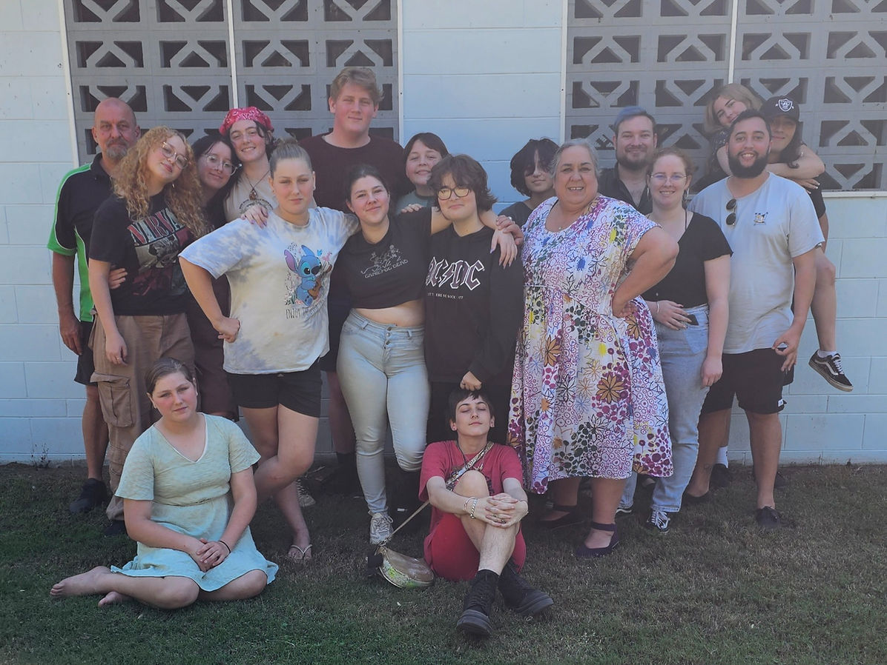

## Main Camp

MAD Camp programs run from Friday afternoon to Sunday afternoon, four times a year.

---

## Annual Leaders Camp/Training

Held during April school holidays.

---

<object data="MAD2027.pdf" type="application/pdf" style= "display: block; width: 100%; aspect-ratio: 1 / 1.414; max-height: 80vh; border: none; margin: 0; padding: 0;">
<iframe src="MAD2027.pdf">
  
This browser does not support PDFs. Please download the PDF to view it: <a href="MAD2027.pdf">Download PDF</a>.

</iframe>
</object>

---

## Important information

### Bus Times
 
#### **Departure:**
- Isis District State High: 11:00AM
- Kepnock State High: 12:00PM
- Bundaberg North State High: 12:30PM
- Rosedale State School: 1:30PM
- Miriam Vale: 2:15PM
- Camp Grounds: 3:30PM
​

#### **Return\*:**
- Camp Grounds: 3:00PM
- Miriam Vale: 3:45PM
-Rosedale State School: 4:15PM
- Bundaberg North State High: 5:15PM
- Kepnock State High: 5:30PM
- Isis District State High: 6:30PM
​
*Please note return times may change, we will update parents along the way with ETAs for drop-offs
 
### DON'T FORGET TO PACK
 
- Appropriate clothing ~ please bring a change of clean clothing for each day (3 changes), as well as something to sleep in. (Please pack warm clothes in Winter - it gets COLD!)
- Pillow
- Single bed blanket & bottom sheet / sleeping bag
- Toiletries: soap, deodorant, shampoo, toothpaste, toothbrush, towel
- Comfortable shoes such as sandals, sandshoes or thongs (footwear must be worn at all times)
- Costume for Entertainment night (Check the theme with your support person or on our Facebook page)